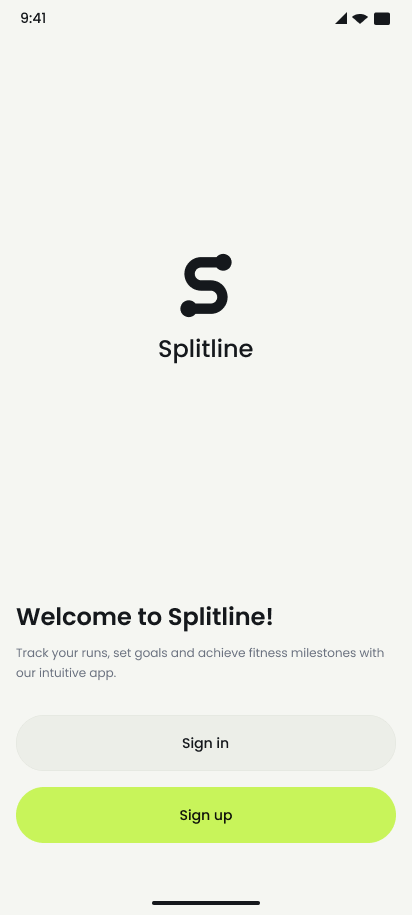
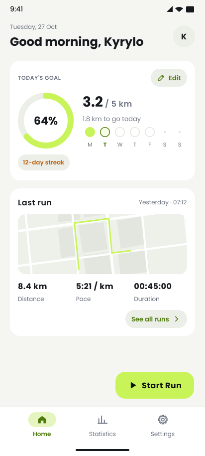
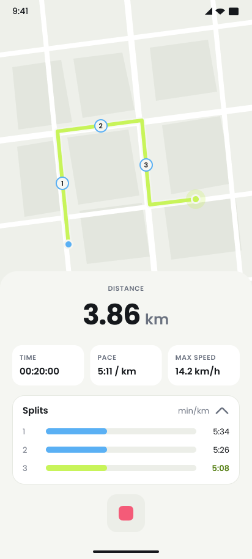
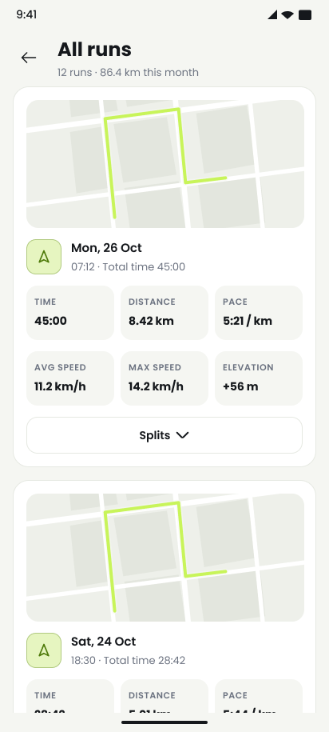
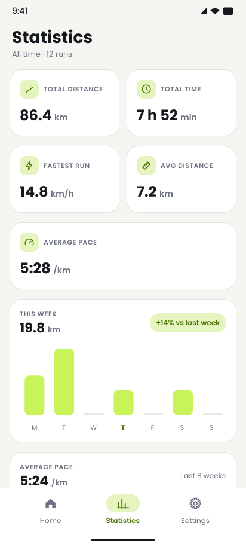
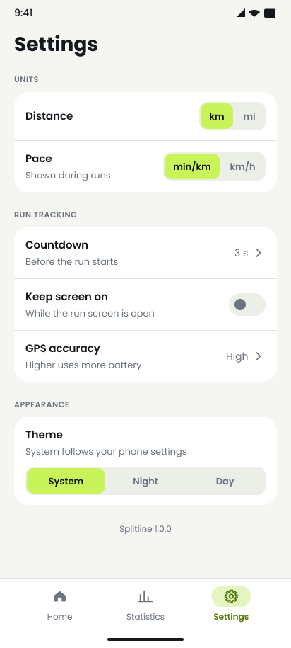

# Splitline

**A multi-module Clean Architecture Android running tracker built with modern Jetpack tools.**

Splitline is a personal running companion that demonstrates scalable and maintainable Android development through a fully modular codebase. It focuses on accurate GPS tracking, reactive data flows, and clean separation of concerns.

---

## About

Splitline tracks runs with GPS in real time, records per-km/mi splits, shows your route on Google Maps, and turns your history into statistics, weekly trends, and daily goals.

It was built from scratch to showcase:

- Strict Clean Architecture with pure Kotlin domain layers
- Multi-module Gradle structure with convention plugins (`build-logic`)
- Background location tracking with a foreground service
- Reactive UI driven by Kotlin Flow and Coroutines (MVI)
- Robust local persistence with Room (foreign keys, cascades, transactions)
- Modern declarative UI with Jetpack Compose + Material 3 and custom Canvas charts

---

## Module Structure

| Layer | Modules | Responsibility |
|-------|---------|----------------|
| **App Shell** | `:app` | Application entry point, global navigation graph, Koin initialization, theme |
| **Feature: Auth** | `:auth:data` `:auth:domain` `:auth:presentation` | Onboarding, local registration & login, password hashing, session persistence |
| **Feature: Run** | `:run:data` `:run:domain` `:run:location` `:run:presentation` | Active run tracking, location observing, splits, run history, daily goals |
| **Feature: Statistics** | `:statistics:data` `:statistics:domain` `:statistics:presentation` | All-time totals, weekly and 8-week trends, charts |
| **Feature: Settings** | `:settings:presentation` | Units, pace format, countdown, GPS accuracy, keep screen on, theme |
| **Core** | `:core:data` `:core:database` `:core:domain` `:core:presentation:designsystem` `:core:presentation:ui` | Shared repositories, Room DAOs & entities, domain models, `Result`/`DataError`, design system components |

Domain modules contain pure Kotlin only — zero Android framework dependencies.

---

## Technical Highlights

- **Clean Architecture**  
  Domain models, the running tracker, and the split and goal calculators are pure Kotlin. Business logic is independent of the Android framework.

- **Location tracking**  
  Fused Location Provider wrapped in a `LocationObserver` Flow. A foreground service (`ActiveRunService`) keeps tracking with an ongoing notification while the app is in the background.

- **Run splits**  
  `LocationDataCalculator` computes distance, pace, and per-km/mi splits from location timestamps. Splits appear live on the map and in a sheet, and are stored with each run.

- **Reactive data layer**  
  UI is driven by `StateFlow` / `Channel` events in an MVI setup. Database queries are reactive Room Flows.

- **Room persistence**  
  - Foreign keys with `ON DELETE CASCADE` between users, runs, splits, and daily goals  
  - `@Transaction` relation queries (`RunWithSplits`) that load runs together with their splits  
  - Aggregated statistics queries (`StatisticsDao`, `RunStatsRow`)

- **Dependency Injection**  
  Koin with modular graphs (`singleOf`, `viewModelOf`). Constructor injection throughout.

- **UI**  
  Jetpack Compose + Material 3. Custom Google Maps style, split markers, Canvas-drawn weekly bar chart and goal ring, light/dark themes.

---

## Feature Tour

| Onboarding & Authentication | Home & Daily Goal |
|-----------------------------|-------------------|
|  |  |
| Onboarding flow, local registration & login | Last run, daily goal ring, week strip |

| Active Run | Run History |
|------------|-------------|
|  |  |
| Live map route, duration, pace, splits | All runs with route preview and splits |

| Statistics | Settings |
|------------|----------|
|  |  |
| Totals, this week vs last, 8-week trend | Units, countdown, GPS accuracy, theme |

---

## Tech Stack

| Category | Technology |
|----------|------------|
| Language | Kotlin 2.4 |
| UI | Jetpack Compose, Material 3 |
| Architecture | Clean Architecture + MVI + Multi-module Gradle (convention plugins) |
| Persistence | Room (SQLite + relations + foreign keys) |
| Async | Kotlin Coroutines & Flow (`StateFlow`, `Channel`) |
| DI | Koin |
| Navigation | Jetpack Navigation (type-safe Compose routes) |
| Location & Maps | Fused Location Provider, Google Maps Compose, Maps Utils |
| Security | AndroidX Security Crypto (encrypted session storage) |
| Images | Coil |
| Min / Target SDK | 26 / 36 |

---

## Engineering Decisions

- Domain layer is framework-agnostic (pure Kotlin)
- Location tracking isolated in its own module behind a domain interface
- Reactive database queries and UI state management
- Relational consistency through foreign keys and cascades
- Shared build configuration through Gradle convention plugins
- Clean separation between data, domain, and presentation layers

---

## Download

Pre-built release APKs are available on the [GitHub Releases](https://github.com/KirillYakub/Splitline/releases) page.